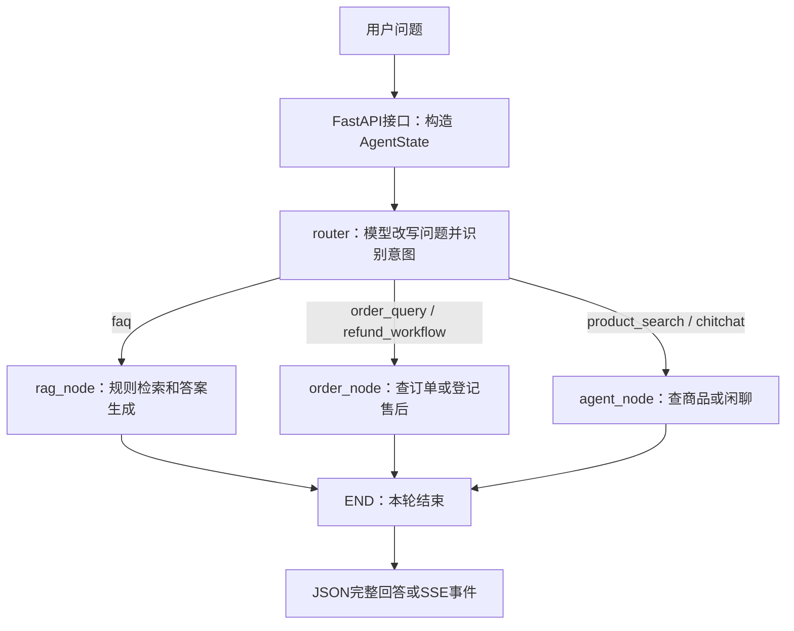

# custcare-agent-py：零基础源码讲解与面试口述手册

> 阅读日期：2026-11-02。任务：CUSTCARE-READ-20261102-001。
> 完整阅读 15 个 app Python 文件及 2 个根入口，核对相关前端、Java 网关与交易服务源码。
> “已实现”指源码存在对应逻辑，不表示真实环境已联调成功。10 项隔离检查结果见同目录 CUSTCARE_READ_VALIDATION.md。
> 本次不修改业务逻辑，不调用付费模型，不执行真实订单/退款，不连接真实 MySQL/Qdrant。

## 1. 先用一句话理解

这是万悦商城的一个独立 Python AI 客服服务：接收用户问题，让模型识别问题属于哪种业务，再调用相应的规则知识检索、订单查询、售后登记或商品查询，最后组织并返回答案。

它是“AI 应用开发”，不是从零训练大模型。默认聊天模型是配置中的 qwen-plus，Embedding 模型是 text-embedding-v3；请求通过阿里百炼的兼容协议发送。代码中类叫 ChatOpenAI / OpenAIEmbeddings，不等于实际调用 OpenAI 官方服务，真正提供商取决于 base URL 和模型配置。

把商城比作商场：前端是顾客接待屏，API 是窗口，FastAPI 是接待系统，LangGraph 是业务分流流程，模型负责理解和表达，MySQL 是账本，Qdrant 是规则资料检索系统，Java 商品/订单服务是业务柜台。

### 1.1 入门名词

| 名词 | 白话解释 | 项目对应 |
| --- | --- | --- |
| 前端 | 用户点击、输入和查看答案的页面 | Vue 客服页 |
| 后端 | 接收请求并完成业务处理的程序 | Python 服务 + Java 微服务 |
| 微服务 | 可以独立启动、部署、维护的小服务 | Python 客服默认端口 8088 |
| HTTP / API | 程序之间发消息的约定 / 业务窗口 | GET /custcare/answer 等 |
| JSON | 用字段和值组织数据的文本格式 | message、intent、data 等 |
| 数据库 | 长期保存数据的系统 | MySQL |
| ORM | 用 Python 类/对象映射数据库表/行 | SQLAlchemy |
| Prompt | 给模型的任务要求和上下文 | ROUTER_PROMPT、RAG_PROMPT 等 |
| Embedding | 把文本变成用于比较含义的数字数组 | 默认 1024 维稠密向量 |
| RAG | 先找资料，再让模型结合资料回答 | 规则问答分支 |
| 状态 | 本轮任务中共享的信息包 | AgentState |
| SSE | HTTP 连接中连续向前端发送事件 | session、intent、action、message、end |

## 2. 必须先分清 Python 与 Java 两套客服

仓库里同时存在：
- Python 客服：`C:/Users/35998/Desktop/job/project/wanjoyMall/custcare-agent-py`，默认 8088。
- Java 客服：`C:/Users/35998/Desktop/job/project/wanjoyMall/custcare-service`，默认 8087。

核对仓库现有前端/网关：
1. 前端 `C:/Users/35998/Desktop/job/project/wanjoyMall/frontend/src/lib/api.ts` 仍请求 GET /custcare/answer。
2. `C:/Users/35998/Desktop/job/project/wanjoyMall/frontend/vite.config.ts` 普通 /api 默认代理到网关 8080。
3. `C:/Users/35998/Desktop/job/project/wanjoyMall/deploy/nacos/wm-gateway-routes.json` 客服 URI 仍为 lb://custcare-service，只匹配 /custcare/answer。
4. Python 未见 Nacos 注册代码，也没有通过仓库默认路由被接入。

因此：Python 提供兼容的旧路径，但“接口路径相同”不意味着“前端已经访问 Python”。远程 Nacos 和实际运行状态本次未读取，不能根据仓库模板断定远程配置一定相同。

Java 客服的既有 FAQ、敏感词过滤、工具调用和会话记忆，不应直接当作 Python 已实现的能力；两套服务的库表/向量配置也不能不加核对就混用。

## 3. 文件职责：从哪里读起

以下所有路径均为源码绝对路径。

| 文件 | 职责 | 阅读时关注 |
| --- | --- | --- |
| [run.py](C:/Users/35998/Desktop/job/project/wanjoyMall/custcare-agent-py/run.py) | 开发启动入口 | uvicorn.run、reload=True |
| [根 main.py](C:/Users/35998/Desktop/job/project/wanjoyMall/custcare-agent-py/main.py) | 模板 Hello 入口 | 不是客服服务启动入口 |
| [app/main.py](C:/Users/35998/Desktop/job/project/wanjoyMall/custcare-agent-py/app/main.py) | 创建 FastAPI、跨域、注册接口、健康信息 | include_router、健康检查边界 |
| [config.py](C:/Users/35998/Desktop/job/project/wanjoyMall/custcare-agent-py/app/core/config.py) | 从环境变量/.env/默认值读取参数 | 路径相对当前工作目录 |
| [database.py](C:/Users/35998/Desktop/job/project/wanjoyMall/custcare-agent-py/app/core/database.py) | 数据库引擎、连接池、请求 Session | get_db、commit、close |
| [orm.py](C:/Users/35998/Desktop/job/project/wanjoyMall/custcare-agent-py/app/models/orm.py) | 定义 5 张表的对象映射 | 定义类不等于已经建表 |
| [chat.py](C:/Users/35998/Desktop/job/project/wanjoyMall/custcare-agent-py/app/api/v1/chat.py) | 完整回答、SSE、评价接口 | 初始状态、thread_id、审计差异 |
| [kb.py](C:/Users/35998/Desktop/job/project/wanjoyMall/custcare-agent-py/app/api/v1/kb.py) | 知识查询和全量向量同步 | status=1、逐条同步、失败列表 |
| [state.py](C:/Users/35998/Desktop/job/project/wanjoyMall/custcare-agent-py/app/graph/state.py) | 工作流共享状态 | messages 没有追加 reducer |
| [builder.py](C:/Users/35998/Desktop/job/project/wanjoyMall/custcare-agent-py/app/graph/builder.py) | 构建节点/条件边/内存检查点 | 一次路由后只执行一个分支 |
| [router.py](C:/Users/35998/Desktop/job/project/wanjoyMall/custcare-agent-py/app/graph/nodes/router.py) | 问题改写、意图识别、订单号提取 | JSON 解析、失败转 FAQ、覆盖选单 |
| [rag_node.py](C:/Users/35998/Desktop/job/project/wanjoyMall/custcare-agent-py/app/graph/nodes/rag_node.py) | 知识检索、低分兜底、生成答案 | score 与 rrf_score 不同 |
| [order_workflow.py](C:/Users/35998/Desktop/job/project/wanjoyMall/custcare-agent-py/app/graph/nodes/order_workflow.py) | 最近订单查询和本地售后登记 | 未实际退款，未查归属/状态 |
| [agent_reasoning.py](C:/Users/35998/Desktop/job/project/wanjoyMall/custcare-agent-py/app/graph/nodes/agent_reasoning.py) | 闲聊或商品推荐 | 固定调用普通 Python 查询函数 |
| [embeddings.py](C:/Users/35998/Desktop/job/project/wanjoyMall/custcare-agent-py/app/rag/embeddings.py) | 稠密和稀疏向量生成 | 惰性客户端、单字/片段词频、hash |
| [hybrid_retriever.py](C:/Users/35998/Desktop/job/project/wanjoyMall/custcare-agent-py/app/rag/hybrid_retriever.py) | 写 Qdrant、两路召回、手工 RRF | 命名向量、稳定点 ID、排序 |
| [mall_tools.py](C:/Users/35998/Desktop/job/project/wanjoyMall/custcare-agent-py/app/tools/mall_tools.py) | HTTP 查询商品/订单，格式转换 | 身份头、价格单位、异常 |

其他文件：pyproject.toml 声明依赖；uv.lock 记录锁定依赖；.python-version 指向 3.11；.venv 是隔离的 Python 运行环境；.env 是本机配置；.env.example 是配置样例。Python README 当前为空，data 当前未发现文件。不得把 .env 密钥拷贝到教学资料。

## 4. 服务怎么启动

启动链：run.py -> Uvicorn -> 导入 app.main:app -> 创建 FastAPI、注册路由 -> 接收请求。

- FastAPI：定义接口、请求模型和应用逻辑。
- Uvicorn：真正监听端口，接收 HTTP/ASGI 请求并交给应用。
- app.main:app：前者是 Python 模块，冒号后是该模块的 app 变量。
- 0.0.0.0：监听所有本机网卡，不是浏览器应访问的目标主机。
- reload=True：开发热重载配置，不是生产部署配置。

### 4.1 运行前提（本次没有实际启动）

需要核对：Python 3.11+、依赖环境、.env 中的本机配置、MySQL 独立库及 5 张表、Qdrant 已存在的集合与命名向量、模型凭据、内部 Java 服务可达和身份协议一致。

源码未见 create_all、数据库迁移或 create_collection；在仓库 sql/deploy 中未找到这套 Python 库表/集合的初始化定义。ORM 类不是建库脚本；不能只安装依赖就声称已经具备运行前提。

Qdrant 集合需要与代码的 dense/sparse 命名以及 Embedding 维度匹配；具体线上集合的距离度量和维度未检查，不能假定已经符合配置。

在前提核对完成后，可以使用以下启动方式（示例说明，未执行）：

```powershell
Set-Location 'C:\Users\35998\Desktop\job\project\wanjoyMall\custcare-agent-py'
& 'C:\Users\35998\Desktop\job\project\wanjoyMall\custcare-agent-py\.venv\Scripts\python.exe' 'C:\Users\35998\Desktop\job\project\wanjoyMall\custcare-agent-py\run.py'
```

也可在服务目录使用 uv sync / uv run python run.py，但安装会影响依赖环境，实际运行还可能调用模型/数据库；本次均未执行。

健康接口 GET / 返回 healthy 及配置摘要，只说明应用能够响应该接口，不探测 MySQL、Qdrant、模型或 Java 服务。它不能证明客服真实业务可用。

## 5. 对外接口

| 方法与路径 | 用途 | 当前边界 |
| --- | --- | --- |
| GET / | 服务信息 | 非依赖就绪检查 |
| GET /custcare/answer | 兼容旧客服，返回完整答案 | 保存 assistant 消息，不返回 message_id |
| POST /custcare/chat/stream | SSE 输出会话/业务/文本事件 | 完整图运行后切片；不保存 ChatMessage |
| POST /custcare/feedback | 对 message_id 点赞/点踩 | 没有用户归属校验；feedback 未限制只能 ±1 |
| GET /custcare/kb/chunks | 查询全部知识切片 | 无分页；无本地管理员鉴权；含停用记录 |
| POST /custcare/kb/sync-all | 同步启用知识切片到 Qdrant | 无本地管理员鉴权；不清理旧向量 |

SSE 请求字段：message 必填，session_id 与 selected_order_id 可选。完整回答请求参数只有 message，不支持传 selected_order_id。

Python 只读取 X-User-Id，没有验证 JWT。完整回答登录用户会话为 user_<id>，匿名共用 anonymous；SSE 允许客户端传会话号，否则登录用户同样固定 user_<id>，匿名生成随机会话号。session_id 只是状态关联标识，不是登录凭证。

返回 {code:404} 不等于 HTTP 状态码 404；feedback 的“消息不存在”分支只是返回字典，没有显式设置 HTTP 404。

## 6. LangGraph：理解整个业务流程



这是 Python 内部的实际分流逻辑；图中不表示现有前端/网关已经接入 Python。

### 6.1 State / Node / Edge

- State：各环节共享的任务单。
- Node：完成一项处理的函数，返回需更新的字段。
- Edge：决定下一步去哪的连线。
- 条件边：根据 intent 选哪个业务节点。
- compile：把声明的流程构成可调用图。
- ainvoke：异步执行一整轮图并得到结果。
- MemorySaver + thread_id：按会话关联图的内存检查点。

这不是“多 Agent 团队”，也没有自由规划/反复调用工具的 ReAct 循环。每轮是 router -> 一个分支 -> END；工具由代码固定调用，而不是 bind_tools 后由模型任意调用。

### 6.2 AgentState 关键字段

- messages：消息列表，当前每个请求只传一条 HumanMessage。
- user_id / session_id：业务用户编号 / 会话标识。
- current_input：本轮原始提问。
- rewritten_query：模型尝试补全后的独立问题。
- intent：五分类意图。
- retrieved_docs / confidence_score：召回资料及门槛判断分数。
- selected_order_id：前端选单或模型提取的订单号。
- action_required：告诉前端展示选单等动作。
- final_answer：最后给用户看的答案。
- order_context：预留字段，本次源码未见实际填充逻辑。

### 6.3 意图与改写

例如：
- “退货运费谁承担” -> faq（通用政策）。
- “我最近的订单是什么状态” -> order_query。
- “我要退这笔订单” -> refund_workflow。
- “推荐一部手机” -> product_search。
- “你好，你是谁” -> chitchat。

改写的设计目标：把“那它能退吗”结合历史改成独立句子。但是当前历史消息链不完整，不能保证真正实现这一效果。

router 使用 temperature=0.0 要求稳定 JSON 输出，解析 rewritten_query、intent、order_id；异常时转 FAQ。temperature=0 不是合法 JSON 或确定业务正确性的保证。当前没有结构化输出 schema/枚举验证，非法意图会被 else 分支送到 agent；模型客户端构造在 try 外，构造阶段失败也不在该异常兜底中。

## 7. RAG：为什么先检索再回答

聊天模型没有天然持有商城最新规则，也不知道私有政策。RAG 就是让它“查材料后开卷作答”。

### 7.1 离线知识同步

现有逻辑从已经存在的 kb_chunks 读取 status=1 的切片：
1. 用内容生成稠密向量。
2. 用内容生成稀疏向量。
3. 转换 point ID。
4. 将 dense、sparse 和 payload（正文、来源、分类、标题路径）upsert 到 Qdrant。
5. 在 MySQL 写 vector_id，最后 commit。

没有看到文件上传、PDF解析、自动切片、知识新增/修改审核等完整入库流程；kb_chunks 假定已由外部填充，token_count 是字段，不代表已经实现 token 计数。

同一个切片用同一个点 ID upsert，可覆盖旧向量而不正常累加重复点。数字字符串转整数，合法 UUID 保留，其他字符串转稳定 UUID5。注意类型注解返回 str，而实际数字路径会返回 int；这是注解精确性问题。

### 7.2 稠密向量与稀疏向量

稠密向量由模型产生，默认维度为 1024，主要表达语义。例如“退货运费谁出”和“退回商品的邮费由谁承担”字面不同但含义相近。

本项目稀疏向量不是 BM25：
- 正则把中文按单字、英文和数字按连续片段切分。
- Counter 计算频次。
- 权重 = 某词出现次数 / 总词数。
- 索引 = abs(hash(word)) % 1000000。
- 空文本返回零权重占位。

例：“退退货 PHONE phone” -> 退 2 次、货 1 次、phone 2 次，权重依次 0.4、0.2、0.4。没有 IDF，也没有 BM25 的文档长度校正。

重要缺陷：Python 内置字符串 hash 默认跨进程不稳定；不同启动/不同 worker 可能给同一个词不同索引，导致建索引和查询对不上。还有模百万后的碰撞风险，源码未合并不同词发生碰撞时的重复索引。生产建议使用稳定词典 ID 或确定性哈希并合并碰撞权重，固定建库与查询算法版本；更换后需要重建稀疏索引。只临时固定 PYTHONHASHSEED 不应代替完整索引设计。

### 7.3 两路召回与 RRF

默认 TOP_K=3：稠密和稀疏各取 6 条候选，然后本地融合，只保留 3 条。代码按顺序调用两次 query_points，不是并行调用。

本项目 RRF 公式（名次从 1 开始）：

```text
融合分 = Σ 1 / (60 + 名次)
```

同一切片在两路都靠前，就累加两份分；先按融合分排序。相比直接加两路原始分，按排名更容易避免两路分数尺度不同的问题。k=60 是本项目写死的参数，不应说成当前所有 Qdrant 原生 RRF 的默认值。

### 7.4 score != rrf_score != 真实正确率

源码返回：
- rrf_score：决定融合排序。
- score：有稠密命中时用稠密原始分；只稀疏命中时固定 0.5。
- confidence_score：取 RRF 排名第一条的 score。
- CONFIDENCE_THRESHOLD：默认 0.65。

所以“confidence=0.8”不能说成“答案有 80% 概率正确”。此外第一条不是最高稠密分结果。

隔离示例：A 稠密 0.92、B 稠密 0.61；稀疏 B 第一、C 第二。融合排序 B/A/C，当前门槛看 B 的 0.61，仍会兜底；C 只稀疏命中是 0.5。应通过标注问题集校准门槛，并评估召回/重排与回答依据，不是随意调小参数。

### 7.5 高分与低分处理

高分：拼接正文和来源 -> RAG_PROMPT -> 模型生成 -> 附去重后的文档名称。
低分或无资料：返回固定兜底 -> 尝试写 flywheel_pool，保存原问题、改写问题、失败类型、召回快照。

提示词禁止编造有助于约束，但不能证明“零幻觉”。引用名称不等于每句话都有准确证据。失败写池时只打印错误，仍返回“已反馈运营”的话术，也不能保证运营真的收到问题。Qdrant/Embedding 调用抛异常没有在该节点被统一转成低分兜底，检索故障与无检索结果不是同一情况。

## 8. 订单与售后

### 8.1 查询最近订单

order 节点先要求 user_id>0，然后调用 mall_tools 中 get_my_recent_orders：
- GET /orders/mine，默认节点取 3 单，售后选单时取 5 单。
- 每次新建 httpx.AsyncClient，timeout=3.0。
- 将订单号转换为字符串；金额 totalFee 从分转元；状态码转中文。
- 只列订单摘要：编号、金额、状态、下单时间。

未实现物流快递轨迹和针对 selected_order_id 获取特定订单详情；意图名称/提示语提到物流，不等于对应物流接口已经存在。

### 8.2 身份协议目前不一致

Python 入站/出站使用 X-User-Id。
Java 网关校验 JWT 后注入 user-info。
Java UserInfoInterceptor 从 user-info 读取用户，并存入 UserContext。
交易 service 从 UserContext 查询本人订单，没有按 X-User-Id 读取身份。

因此按当前仓库源码，直接只发送 X-User-Id 的 Python 订单调用不能建立 Java UserContext。不能声称当前已成功联调。应统一身份协议，并让可信网关或服务间认证建立身份，禁止外部绕过网关直连。仅改变头名不能解决伪造身份问题。

### 8.3 售后流程实际做了什么

没有订单号：查最近 5 单 -> 返回 action_required.type=select_order -> 前端显示选项 -> 用户再次发请求。这一轮已经 END，没有 LangGraph interrupt/resume。
有订单号：生成 TK+8位UUID前缀 -> 在本地 aftersales_tickets 插入 REFUND/PROCESSING 工单 -> 返回成功话术。

没有调用支付退款，没有调整订单状态，没有扣/返余额，没有校验订单是否本人所有、状态是否可退，也没有防重复提交。UUID前缀只有32位随机空间，不能承诺工单编号永不冲突。

路由节点还有一个选单问题：它返回模型提取 order_id；若模型没在消息中提取到，返回 None，就覆盖前端已经传来的 selected_order_id。正确修复还需要保持待处理意图，而不是只保留订单号。

返回话术中的“审核通过24小时原路返回”“售后中心查看进度”没有对应退款和查询链路保证，不能当作已实现功能或确定政策。这些涉及资金/承诺的表述应收敛为“本地申请已登记，实际审核退款以业务系统为准”。

## 9. 商品推荐与闲聊

商品分支：把整句 rewritten_query 当关键词 -> 调用商品 /search/list -> 只保留 status=1 -> 金额从分转元 -> 将数据交模型写推荐话术。

工具函数支持 brand、min_price、max_price，但当前 agent 节点只传 keyword 和 limit；“2000元以内的华为手机”未自动提取品牌和预算用于接口过滤。整句自然语言直接作为关键词，也可能降低搜索效果。这是后续改进方向，不是已有结构化导购。

商品/售后选单分支有错误表达问题：部分路径没有先看 success，服务故障可能被说成“没有商品”或“没有可售后订单”。应该区分成功为空与依赖不可用。

闲聊分支直接调用模型，temperature=0.7；商品/RAG生成用0.3，路由用0。温度表达更保守/更发散的倾向，不是确定性、安全性或事实正确性的承诺。

## 10. 数据库和持久化边界

| ORM 类 / 表 | 目的 | 当前使用情况 |
| --- | --- | --- |
| KbChunk / kb_chunks | 规则切片正文、来源、分类、同步标识 | kb 列表和同步使用 |
| ChatSession / chat_sessions | 会话元数据 | 定义但接口未创建/加载 |
| ChatMessage / chat_messages | 消息、意图、分数、耗时、评价 | GET只保存助手；SSE未保存；不保存用户问题 |
| FlywheelPool / flywheel_pool | 低分问题和点踩回复待审核池 | 自动收集；没有完整审核闭环 |
| AftersalesTicket / aftersales_tickets | 本地售后申请 | 只创建，未见审核/退款/进度接口 |

SQLAlchemy 连接池 pool_size=10、max_overflow=20，是每进程至多30个该引擎连接的配置，不是数据库总体最大30个连接。pool_pre_ping 是取连接时检查；pool_recycle=3600 是连接达到寿命后在再次取用时重建，不是后台每小时扫掉所有连接。

get_db 用 yield 给请求提供 Session，finally close 归还连接；写入处自己 commit。Session 是一次数据库交互/事务的工作对象，不是聊天 session_id，也不是数据库引擎。

### 10.1 多轮记忆为什么不完整

代码用了 MemorySaver 和 thread_id，但：
1. messages 没有 Annotated/add_messages 追加规则。
2. 每次请求都传新列表，只含本轮 HumanMessage，覆盖旧列表。
3. 业务节点不向 messages 追加 AIMessage。
4. router 的“最近6条历史”实际上通常只看到当前用户消息。
5. 不从 ChatMessage 读历史。
6. 内存检查点随进程重启丢失，多 worker 不共享。
7. SSE 接受客户端自定义 session_id，没有校验它属于当前用户。

因此“有检查点”不等于“有完整聊天历史”。修复建议：消息追加 reducer，保存用户和助手成对历史，控制窗口长度，可信的用户-会话归属，持久化检查点，跨实例一致性和同会话并发策略。新增 add_messages 但仍不追加 AIMessage，同样不能完整解决。

### 10.2 数据飞轮当前到哪一步

已实现：低分/无召回问题和点踩内容写待审核池。
未实现：运营审核台、修正答案、发布到知识库、重新向量化、评测回归、模型训练。

点踩接口保存的 query 是固定提示，rewritten_query 装的是助手答复截断，不是完整原始问答对；message_id也没通过当前回答接口返回。反馈闭环需要补原问题关联、响应消息ID和前端接入，不能说用户点踩后模型就会自动学习。

## 11. SSE：数据在流，模型没有边生成边流

事件格式：

```text
event: message
data: {"content":"为您查询"}

```

源码顺序：
1. 先发 session。
2. await app_graph.ainvoke 等整轮完成。
3. 发 intent，若需要再发 action。
4. 把 final_answer 每4个字符切一段，循环发 message。
5. 发 end。

这可以传业务事件和分块文本，但不降低模型完成前的等待时间，也没有人为发送间隔，所以前端不一定稳定呈现“打字动画”。真正逐token流式应使用模型/图的流式接口，明确只转发给用户看的最终回复，不暴露路由 JSON 和内部事件，并处理超时、心跳、断连、错误事件、代理缓冲以及最终消息落库。

POST SSE 前端一般需要支持请求体和自定义头的 fetch 流式读取等机制；浏览器原生 EventSource 不能直接按此 POST JSON 接口调用。当前既有 Vue 客服页未接入这组 SSE/action 事件。

## 12. 并发与可靠性

async/await 的目的，是在等待支持异步的网络操作时让出执行权处理别的请求，不是把所有普通调用自动变成后台任务。

本项目模型 ainvoke 和 httpx 查询是异步；但 rag_node 直接调用同步 Embedding/Qdrant，且多个 async 节点内直接使用同步 SQLAlchemy，会阻塞事件循环。普通同步工具函数不会因为外层函数 async 就自动运行在线程池。

改进可以选原生异步客户端，或对阻塞工作使用受控线程池；同步 Session 的创建/使用/关闭放在同一受控工作单元，不把一个 Session 随便跨线程共享。需要核对并发量、连接池和线程池容量，不是只给函数加 async。

其他边界：缺少全局模型/检索异常处理、明确总耗时预算；每次工具调用重建客户端没有复用连接；KB同步逐条且全量加载；CORS * + credentials 过宽，跨域不是鉴权；本地知识管理接口和反馈接口未实现权限控制；DB密码直接拼接URL遇特殊字符有编码风险；部分原始异常会回给用户。

## 13. 优先级建议（均为建议，未实施）

1. 先解决可信身份、管理员鉴权、订单归属、会话归属和敏感凭据保护。
2. 再修复前端选单覆盖、多轮消息记忆和售后承诺超出能力的问题。
3. 再稳定稀疏索引、知识删除/停用同步、跨库一致性。
4. 增加真实流式、异步客户端、连接复用、超时/错误事件。
5. 补自动化测试、评测集、监控与部署文档。

.env.example 含非空、形似 API key 的值；真实性未调用验证。样例应使用占位符；若那是真实凭据，应由用户轮换并检查是否曾进入版本历史。绝不在本手册复制该值。

MySQL与Qdrant不是同一事务：当前向量写入先发生，MySQL commit 可能失败；单条失败还可能保留旧向量，停用不自动清除。可考虑同步状态、任务队列/Outbox、重试、版本号和检索时状态过滤；不能把重试描述为已实现。

## 14. 面试口述：30题（根据源码实事求是）

下面是可练习的表达模板。仅描述自己真正做过的工作；如果只是学习过项目，可把“我实现了”改成“我阅读和分析的项目采用了”。没有线上数据就不要编QPS、命中率、延迟或提升百分比。 本手册提到的隔离验证由本次分析执行，不代表读者本人已经开发或验证过；练习时请改为“阅读报告中的隔离验证显示”，实际亲自复现后再说“我验证了”。

### Q1 请介绍这个项目

“这是商城的Python智能客服服务，用FastAPI对外提供接口，用LangGraph把客服请求分成几个固定业务分支。用户提问后，模型先做意图识别和问题改写，规则问题用MySQL知识切片和Qdrant检索，商品与订单通过HTTP查询Java服务，售后目前只登记本地工单。它的重点是把语言模型接到可控业务流程，而不是让模型直接决定资金操作。当前真实接入、完整记忆和退款闭环还有待完善。”

### Q2 为什么拆成微服务，还选择Python

“拆成独立服务可以让AI依赖、模型配置和迭代节奏与商城业务相对解耦。Python这边调用模型和编排流程比较方便，Java仍负责商品订单的业务规则。语言不同不是问题，因为通过HTTP和JSON通信。但拆分也引入网络故障、身份透传和部署成本，不是微服务一定更好。”

### Q3 FastAPI和Uvicorn有什么区别

“我把FastAPI理解成定义接口和处理逻辑的框架，Uvicorn是运行这个应用并监听端口的ASGI服务器。run.py用Uvicorn加载app.main模块里的app。根main.py只是模板打印，不是服务入口。reload是开发时方便改代码用的，生产不应照搬。”

### Q4 什么是RAG，为什么不用模型直接回答

“RAG就是先检索资料，再把资料和问题一起给模型作答。商城规则是私有的，还会更新，不能假设模型训练时已经知道，所以用知识库提供依据。这样更容易更新和回查来源，但它不能保证没有幻觉，检索是否正确、资料是否最新、答案是否忠于资料仍要验证。”

### Q5 为什么同时用MySQL和Qdrant

“MySQL保存规则正文、分类、状态以及消息工单这些结构化数据，Qdrant保存检索需要的向量和资料payload。前者便于业务管理，后者便于按语义或关键词召回。两个存储职责不同，而且不是一个事务，所以同步失败和知识停用后的旧向量都得额外处理。”

### Q6 Embedding是什么，1024维是什么意思

“Embedding把一段文本转成数字数组，目的是比较文本的语义表示。1024维就是这组表示有1024个数，不是1024个关键词，也不代表文本只有1024字。项目默认用text-embedding-v3并设置1024维，真正运行时必须与向量库配置一致，换模型也不能直接混用旧向量。”

### Q7 稠密检索和稀疏检索有什么区别

“稠密检索更侧重含义，换一种说法也可能找出相关规则；稀疏检索更侧重字词出现情况，适合具体关键词匹配。项目两路各召回候选，再融合。我也注意到它的稀疏向量只是分词后的归一化词频，不是标准BM25，中文按单字切也比较粗糙。”

### Q8 什么是RRF，为何不直接加分

“RRF按文档在每路结果中的名次给分，再累加，排得越靠前、同时被多路命中的文档通常越靠前。这样不必直接比较语义分和关键词分的数值尺度。项目写的是1除以60加名次，再取前三条。这个融合分用于排序，不代表模型答案正确率。”

### Q9 0.65阈值有什么依据

“代码里0.65是默认业务参数，我没有看到标注评测来证明它最优。实际判断取的是RRF第一条的稠密原始分，不是RRF分，也不是最高稠密分，只有稀疏命中的结果还是固定0.5。后续我会用真实问题标注集评估错误回答和拒答的取舍，而不是凭感觉把阈值降低。”

### Q10 怎样减少幻觉

“我会先把规则问题限制到知识库，低分不让模型自由编政策，答案保留来源，再评估回答是否有依据。订单金额和状态必须用业务接口结果，涉及退款的承诺必须来自真实业务规则。现在提示词有约束，但订单节点的固定退款话术仍超过已实现能力，所以不能说项目已经零幻觉。”

### Q11 LangGraph的State、Node、Edge是什么

“State像一张共享任务单，保存当前问题、意图、资料和答案；Node是一道处理工序，返回要更新的字段；Edge决定下一步去哪。这个项目是先走router，然后根据意图选知识库、订单或导购节点，最后结束。我不会把这种单轮固定分流说成多个自主Agent协作。”

### Q12 这是Function Calling或ReAct吗

“严格说，当前Python这套主要是显式工作流。模型输出意图后，程序固定调用search_products或get_my_recent_orders，没有看到bind_tools、ToolNode或模型自主工具循环。因此可以说它接入了业务查询函数，但不能把它包装成完整的Function Calling/ReAct系统。仓库另有Java客服工具调用实现，需要分开讨论。”

### Q13 多轮对话怎么实现，当前有什么问题

“设计上可以用thread_id和checkpointer关联每个会话，再按消息追加规则保存历史。当前虽然用了MemorySaver，但messages没有add_messages，每次请求只传当前HumanMessage，旧历史被覆盖，助手回答也没追加。我做了隔离检查，同一个thread第二次只剩本轮消息，所以目前不能声称完整多轮记忆已经实现。”

### Q14 如何修复记忆并支持多实例

“先让messages按add_messages等规则合并，保存用户和助手的成对消息，给历史做窗口或摘要。然后用可信用户绑定session_id，检查归属，避免会话串线。生产再选持久化checkpointer，解决重启和多个实例不共享的问题。同一会话并发发两条消息也要有序处理，单纯加一个内存变量不够。”

### Q15 SSE与真正模型流式有什么区别

“SSE是传输方式，模型流式是生成方式，二者不一样。当前接口先发会话号，然后等整张图执行完，把完整答案每四个字符发送一次，所以是分块输出，不是边生成边显示。真正流式要接模型或图的stream事件，只转发面向用户的答案，并处理错误、断连和最终落库。”

### Q16 为什么选择SSE而不是WebSocket

“如果需求是用户先提交问题、服务端持续推答案，SSE用HTTP就能表达这类单向推送，通常没必要为了这个场景引入双向长连接。持续双向实时通信才更适合考虑WebSocket。当前是POST SSE，前端要用支持请求体和头的流式读取方式，不能直接当普通EventSource GET来调用。”

### Q17 Python是async接口，为什么还可能卡

“async只是在执行支持异步的等待操作时让出执行权，不会把里面所有函数变异步。项目模型和httpx部分是异步，但同步Embedding、Qdrant和数据库调用直接放在async节点里，会阻塞事件循环。我会换异步客户端或受控线程池，并确保数据库Session不被随意跨线程共享。”

### Q18 用户身份如何安全传递

“身份应该来自校验JWT的网关或者可靠的服务间认证，而不是相信前端随便传一个用户ID。这里Java用user-info，Python用X-User-Id，协议没对齐，不能直接联调。修复时要统一可信身份头并限制内部端口访问，不能只是把两个头名改一样就认为安全。”

### Q19 售后真的退钱了吗

“没有。当前Python售后只在独立数据库登记一条工单，没有调用支付退款，也没改订单状态或余额。它还没有校验订单归属和可退状态，所以我只会描述成售后登记原型。真实退款必须交给业务服务控制，增加资格校验、用户确认、幂等和审计，不能由模型随意触发。”

### Q20 前端选完订单为什么可能还要再选

“因为请求虽然带了selected_order_id，router又用模型提取的order_id更新这个字段。如果模型返回null，已经选好的订单就被清掉。我会优先保留经过后端验证的显式选择，并保存当前等待的业务意图，再去解析文本补充信息。只保留订单号但忘了待退款意图，也可能继续走错分支。”

### Q21 怎么避免重复退款或重复工单

“当前代码没有做幂等，连续提交会生成不同工单号，随机ID不等于业务幂等。真正实现时可以为一次业务申请设置幂等键，再用唯一约束、状态机和事务保证同一次操作只处理一次。支付退款还要处理回调、重试和对账，这些现在都没有落地。”

### Q22 数据飞轮是不是会自动训练模型

“不是。当前只把低分问题和点踩回复写进待审核池，目的是找知识盲区。要形成闭环还需要运营审核、补规则、重新向量化和评测回归。没有看到训练或自动发布链路，而且点踩记录也不是完整问答对，所以我不会说用户点一下模型就学会了。”

### Q23 知识同步为什么不能认为强一致

“因为向量写入Qdrant和MySQL提交不是同一个事务。可能向量已更新但MySQL提交失败，也可能某条同步失败继续保留旧向量。现在停用知识也不删除向量。我会考虑同步状态、异步任务与重试、版本校验以及检索阶段过滤，让问题可追踪可恢复，而不是承诺跨库原子一致。”

### Q24 稀疏向量实现最大的风险是什么

“最容易被忽略的是用了Python内置hash做持久索引。字符串hash默认在不同进程可能不同，知识入库和后续查询会对不上，我用不同seed的隔离检查也确认了这一点。改进应使用稳定词典或确定性哈希，处理碰撞并统一版本，改算法后重建索引，而不是只调召回数量。”

### Q25 如何评估这个客服，怎么回答指标

“我会分层评估。意图层看分类和误路由；检索层看Recall@K、MRR或nDCG；答案层看有依据回答、正确拒答和业务状态正确性；系统层看p95延迟、错误率和调用成本。现在没有实际线上评测数据，我只能给评测方案，不能虚构命中率提升多少或扛住多少QPS。”

### Q26 会怎么测试

“先把模型、向量库和Java服务mock掉测流程，覆盖意图路由、低分兜底、金额单位、选单、多轮状态和错误分支。再在独立测试库和测试向量集合做集成，最后评估真实模型和少量受控业务链路。本次阅读做了10项隔离检查，没有操作真实数据，所以不能说集成已通过。”

### Q27 如何优化成本和延迟

“先测各阶段耗时。当前即使FAQ也先调用路由模型，命中规则后还要一次生成模型和一次Embedding，所以不能说FAQ完全不花模型成本。候选方案包括更轻量分类、规则快捷路径、Embedding/可信FAQ缓存、客户端连接复用、两路并行以及真正流式。涉及订单和实时商品不能使用不加区分的跨用户缓存。”

### Q28 为什么健康接口healthy不代表客服可用

“因为现在GET根路径只是返回配置和状态，没有实际检查数据库、向量库、模型和业务服务。它更接近存活信息，业务就绪需要另外验证关键依赖。模型健康检查也要考虑费用和失败频率，不能每次探活都调用一遍付费模型。”

### Q29 安全上线前最先改什么

“我先补可信身份和权限：知识管理只给管理员，会话和反馈查归属，订单退款必须查本人和状态，限制内部端口。再处理密钥、原始异常、输入长度和限流。CORS只决定浏览器跨域访问，并不是鉴权，不能因为配置了跨域就认为接口安全。”

### Q30 目前最大不足，怎么诚实表达

“这个项目的流程划分和检索思路比较清晰，但更像具备几个能力的客服原型。我的优先级是先修身份与业务权限，再补消息历史、选单状态和售后闭环，然后处理索引稳定性、知识一致性及真正流式。哪些已实现、哪些只做隔离验证、哪些是下一步建议，我会分清楚，不拿设计方案冒充生产成果。”

## 15. 连续追问演练

**面试官：你说支持多轮，怎么存历史？**

“这点我会纠正一下：有MemorySaver检查点不代表历史已完整保存。当前接口每次都带一个新消息列表，默认合并会覆盖旧值，而且助手答复没加入messages。我验证后确认这是待修复问题。”

**面试官：那你怎么证明它没记住？**

“我用项目安装的实际LangGraph，保留原AgentState和建图逻辑，把外部模型/业务节点换成模拟函数。同一个thread连续传两次问题，第二次返回messages只有一条当前问题。这是针对状态合并的隔离验证，不涉及真实模型。”

**面试官：add_messages加上就好了？**

“还不完整。要追加助手消息、限制历史长度、绑定用户会话，生产要持久化并处理多实例和同会话并发，否则只是把一个问题换成另外几个问题。”

**面试官：你实现了退款，如何防越权？**

“目前只登记本地工单，并没有实际退款，也没有完整归属校验，所以不能说这部分已经安全上线。真实资金操作我会在业务服务校验，不交给模型做最终授权。”

**面试官：你用了混合检索，怎么知道它更好？**

“理论上它兼顾语义和关键词，但当前没有评测数据证明一定更好。我会用固定标注集比较稠密、稀疏和融合结果，查看Recall@K、排序和最终答复错误，才能报告收益。”

## 16. 零基础学习顺序

1. 理解前端/后端/HTTP/JSON/微服务概念。
2. 学 Python 变量、字典/列表、函数、类、导入、异常、类型注解。
3. 阅读 run.py -> app.main -> chat.py，能讲清“请求进来”和“响应出去”。
4. 阅读 state.py -> builder.py -> router.py，能画出分流图。
5. 阅读 rag_node.py -> embeddings.py -> hybrid_retriever.py，理解资料从哪来。
6. 阅读 mall_tools.py -> order_workflow.py/agent_reasoning.py，理解业务数据从哪来。
7. 阅读 orm.py -> database.py -> kb.py/feedback，理解落库和同步。
8. 最后练记忆、异步、身份、幂等、一致性、评测等工程追问。

每读一个函数问四件事：输入是什么、调用谁、输出是什么、失败怎么办。先能解释调用链，再记技术名词，不必一开始死背全部代码。

## 17. 参考资料与证据范围

- 本项目实现事实：上述绝对路径源码及 CUSTCARE_READ_VALIDATION.md。
- LangGraph Graph API：状态、节点、边与 reducer 的官方说明。
- LangGraph Persistence：checkpointer/thread_id 与 store 的官方说明。
- Qdrant Hybrid Queries：稠密/稀疏融合和RRF按名次融合的官方说明。
- Python官方 Data Model：内置字符串hash的进程随机化说明。
- FastAPI官方 Concurrency and async/await：直接调用普通同步函数不自动进线程池。
- FastAPI官方 Custom Response：StreamingResponse基于生成器发送响应体。

本手册对本地代码的引用不代表上述框架官方为项目背书；外部资料只用于说明通用机制。
