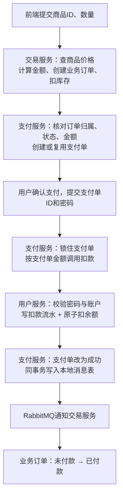

结合你这个项目，先给结论：

**当前实现的是“账户余额支付”，不是微信、支付宝支付。防止扣错钱的核心是：金额由后端确定，扣款以支付单为准，用数据库原子操作和扣款流水保证不会超扣、重复扣，再通过消息和对账同步订单状态。**

不过，**项目已经有这些保护机制，但还存在几个关键缺口，不能直接认为支付链路已经完全安全。**下面分开讲。

## 一、支付链路怎么走？

````

````

这里有三种不同的数据：

|数据|作用|
|---|---|
|**业务订单 `order`**|记录买了什么、买多少、应付多少钱|
|**支付单 `pay_order`**|记录这笔订单的支付金额、支付方式、支付状态|
|**扣款流水 `deduct_record`**|记录哪个账户实际为哪个支付单扣了多少钱|

**业务订单表示“应该收多少钱”，扣款流水表示“实际扣了多少钱”，两者不能混为一谈。**

---

## 二、怎么防止扣错金额？

### 1. 下单金额不相信前端，由后端重新计算

前端下单只提交商品 ID、数量等信息。交易服务查商品服务里的价格，再算：

```
total += item.getPrice() * itemNumMap.get(item.getId());
```

例如商品单价是 **1990 分**，购买两件：

```
订单金额 = 1990 × 2 = 3980 分 = 39.80 元
```

用户在浏览器里把展示金额改成 `0.01` 元，不会改变后端订单金额。

代码：[OrderServiceImpl.java (line 95)](C:/Users/35998/Desktop/job/project/wanjoyMall/trade-service/src/main/java/com/wsy/wanjoymall/trade/service/impl/OrderServiceImpl.java#L95)

### 2. 申请支付单时，再核对业务订单

支付服务不是收到 `amount` 就直接保存，而是查询交易服务，检查：

- 订单是否存在；
- 是否属于当前登录用户；
- 是否仍然未付款；
- 请求金额是否等于订单金额。

金额不一致直接拒绝：

```
if (!Objects.equals(order.getTotalFee(), applyDTO.getAmount())) {
    throw new BizIllegalException("支付金额与订单不符");
}
```

校验后，还会用服务端订单金额覆盖请求金额。

代码：[PayOrderServiceImpl.java (line 143)](C:/Users/35998/Desktop/job/project/wanjoyMall/pay-service/src/main/java/com/wsy/wanjoymall/pay/service/impl/PayOrderServiceImpl.java#L143)

### 3. 真正扣款时，不再让前端决定金额

前端确认支付主要提交：

```
{
  "id": "支付单ID",
  "pw": "密码"
}
```

后端查询支付单，用数据库里的金额扣款：

```
userClient.deductMoney(
    payOrderFormDTO.getPw(),
    po.getAmount(),
    po.getId()
);
```

所以正常支付路径的金额来源是：

**服务端商品价格 → 业务订单金额 → 支付单金额 → 实际扣款金额。**

代码：[PayOrderServiceImpl.java (line 62)](C:/Users/35998/Desktop/job/project/wanjoyMall/pay-service/src/main/java/com/wsy/wanjoymall/pay/service/impl/PayOrderServiceImpl.java#L62)

### 4. 金额使用整数“分”，避免浮点误差

当前金额用整数表示，不使用 `float/double` 计算金额。

不过，**整数也有溢出风险**，后面会讲当前代码需要补的地方。

---

## 三、重复点击、并发支付，怎么避免重复扣款？

项目不是只靠前端禁用按钮，而是有多层保护。

### 第一层：同一个业务订单，只创建一张支付单

数据库升级脚本定义了：

```
UNIQUE KEY uk_biz_order_no (biz_order_no)
```

重复申请复用已有支付单；并发创建时，由唯一索引拦住重复数据。

### 第二层：扣款前锁住支付单

支付服务在事务里执行：

```
SELECT * FROM pay_order WHERE id = ? FOR UPDATE;
```

同一支付单的两个支付请求会排队：

1. 第一个请求拿到锁，完成扣款，将支付单改为成功；
2. 第二个请求拿到锁后发现已经支付，拒绝再次执行。

### 第三层：用户服务用扣款流水兜底

扣款流水的 `pay_order_id` 有唯一索引。

用户服务在**同一个本地事务**中：

```
插入扣款流水
    ↓
扣减账户余额
    ↓
一起提交
```

- 扣款失败：流水一起回滚；
- 相同支付单再次扣款：流水唯一键冲突，按已处理返回。

**支付单行锁防并发；扣款流水防跨服务重试导致的二次扣款。两者解决的不是同一个问题。**

代码：[UserServiceImpl.java (line 76)](C:/Users/35998/Desktop/job/project/wanjoyMall/user-service/src/main/java/com/wsy/wanjoymall/user/service/impl/UserServiceImpl.java#L76)

> 这些唯一索引需要数据库实际执行过升级脚本才成立。仓库里的脚本注明不会由应用自动执行，我这次没有核验运行中数据库的表结构。

---

## 四、并发扣款怎么保证余额不变成负数？

关键不是“先查余额，再减余额”，而是数据库中的一条条件更新：

```
UPDATE user
SET balance = balance - :amount
WHERE id = :userId
  AND status = 1
  AND balance >= :amount;
```

例如账户余额 100 元，两张不同订单同时各扣 80 元：

- 第一笔更新成功，剩余 20 元；
- 第二笔执行时不满足 `balance >= 80元`，更新行数为 0；
- 后端抛出异常，第二笔扣款事务回滚。

**余额判断和余额扣减在同一条 SQL 中完成，避免并发请求都读到“余额足够”。**

此外，扣款前还会拒绝零金额、负金额，并校验密码和账户状态。这里所谓“支付密码”，当前实际上校验的是用户的登录密码字段。

代码：[UserMapper.java (line 17)](C:/Users/35998/Desktop/job/project/wanjoyMall/user-service/src/main/java/com/wsy/wanjoymall/user/mapper/UserMapper.java#L17)

---

## 五、钱扣了，但是接口报错、订单没更新怎么办？

这是支付链路里最容易误解的地方：

> **接口超时，不代表没有扣款。支付服务事务回滚，也不代表远程用户服务的扣款会自动回滚。**

当前支付链路依赖的是**本地事务 + 幂等 + 最终一致性补偿**，不是一个覆盖所有服务的支付大事务。

### 场景 A：用户服务扣款成功，支付服务随后宕机

可能出现：

```
账户：已扣款
支付单：仍待支付
```

项目有定时对账任务：

- 默认每 30 秒执行；
- 查询超过 1 分钟未更新的待支付余额支付单；
- 到用户服务查询扣款流水；
- 已扣款则补齐支付状态，并发送支付成功通知。

代码：[PayReconcileTask.java](C:/Users/35998/Desktop/job/project/wanjoyMall/pay-service/src/main/java/com/wsy/wanjoymall/pay/task/PayReconcileTask.java)

### 场景 B：支付成功，但是 MQ 暂时不可用

支付服务把：

```
支付单改为成功 + 写入待发送消息
```

放在同一数据库事务里，提交后再发 MQ。发送失败通过定时任务重试，超过上限记录失败，等待人工处理。

交易服务消费消息时，仅允许：

```
未付款 → 已付款
```

因此消息重复到达，不会反复改变订单状态。

代码：[PayMessagePublisher.java](C:/Users/35998/Desktop/job/project/wanjoyMall/pay-service/src/main/java/com/wsy/wanjoymall/pay/mq/PayMessagePublisher.java)

前端也做了保护：结果不明确时提示刷新查询，不自动重发扣款请求。

---

## 六、当前代码还有哪些关键问题？

前面讲的是已有机制，下面这些是读代码发现的实际缺口。

### 1. 内部资金接口没有与普通用户接口充分隔离

仓库的本地网关配置转发整个 `/users/**`、`/orders/**`，而：

- `PUT /users/money/deduct` 接收调用方提供的金额和支付单 ID；
- `PUT /orders/{orderId}` 可以直接标记订单已支付。

这些接口里没有看到足够的服务身份鉴权；网关的登录校验也不等于“只允许支付服务调用”。

**如果部署没有额外拦截，普通登录请求就可能绕过正常支付链路。应优先把扣款、标记支付成功等接口收为内部接口，并做服务间鉴权。**

相关代码：[UserController.java (line 35)](C:/Users/35998/Desktop/job/project/wanjoyMall/user-service/src/main/java/com/wsy/wanjoymall/user/controller/UserController.java#L35)、[OrderController.java (line 56)](C:/Users/35998/Desktop/job/project/wanjoyMall/trade-service/src/main/java/com/wsy/wanjoymall/trade/controller/OrderController.java#L56)

### 2. 幂等不能只看“这个编号存在”

当前扣款遇到流水唯一键冲突就直接返回成功，对账也只查流水是否存在。

更严谨的做法是核对：

```
支付单ID相同
并且用户ID相同
并且金额相同
```

**相同幂等键却带着不同金额，应该报错，而不是当作成功。**

### 3. “扣款成功后宕机”与超时关单之间，仍有竞态

当前存在这样的异常窗口：

```
用户服务已经扣款
    ↓
支付服务失败，支付单仍待支付
    ↓
超时任务先把支付单、业务订单关闭
    ↓
对账任务只扫描待支付单，漏掉这笔已关闭单
```

所以，已有行锁**不能完全解决跨服务结果不确定时的关单问题**。

需要补充“支付处理中/结果未知”的处理机制，关单前确认资金结果，并覆盖“已扣款但已关单”的异常对账及退款补偿。

### 4. 服务端计算金额，也要防整数溢出

目前金额计算是：

```
int total;
total += price * quantity;
```

数量累加、乘法、总额累加都可能溢出。即使最后拒绝负数，也无法拦住溢出后变成较小正数的情况。

应该补：

- 购买数量、订单金额的明确上限；
- 使用 `long` 并同步调整数据库字段，或使用精确数值类型；
- 使用 `Math.multiplyExact`、`Math.addExact` 检测溢出。

---

**总结：防止扣错钱不能只做“金额校验”。完整保障需要同时满足：金额可信、账户正确、扣款幂等、余额原子扣减、状态流转受控、异常可对账补偿。你这个项目已经实现了主要框架，但内部接口隔离和异常关单补偿，应当优先完善。**